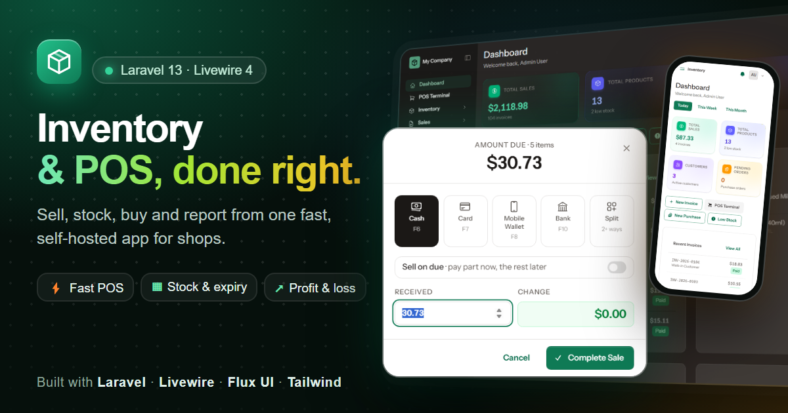

# Inventory & POS – Laravel Inventory Management System

**Live demo: https://qaswasoft.github.io/inventory-preview/** · by **[Qaswasoft](https://github.com/qaswasoft)**



**Inventory** is a self-hosted inventory management system and point of sale (POS) for shops, built with
**Laravel 13, Livewire 4, Flux UI and Tailwind CSS**. Sell at the counter, keep stock right, buy from suppliers
and see what you earn, from one fast single-page app.

- **POS:** barcode scanning, loose goods by weight, discounts and promotions, hold and resume, cash, card,
  mobile wallet, bank, split payment or sell on due, printable 80 mm receipts.
- **Stock:** multiple warehouses, batches and expiry dates (earliest expiry sold first), transfers, stock counts,
  low-stock alerts, weighted-average costing.
- **Purchases:** purchase orders, partial receiving, supplier payments and returns, supplier balances.
- **Customers:** dues with credit limits, member rewards, SMS campaigns.
- **Money:** cash shifts with Z-report, expenses, payment accounts, sales, due and profit & loss reports.
- **Team:** admin, manager and staff roles; light and dark mode; your logo and colours.

**Get it:** coming soon on CodeCanyon.

---

## About this demo

A static, click-through copy of the Laravel inventory & POS app for GitHub Pages. The pages are real
server-rendered snapshots of the running app (same compiled CSS, fonts and markup) with the seeded sample data.
A small demo layer (`demo/*.js`) replaces the server: search dropdowns, a working POS, invoice and purchase forms,
sortable and paginated lists, role switching. Nothing is sent to a server. Everything a visitor changes is kept in
their browser (localStorage, keys `swiftdemo:v1:*`), and the **Reset data** button in the demo bar restores the
sample data.

## What works
- **POS**: search by name / SKU / barcode (Enter on a scanned barcode adds it), item table with qty and weight,
  discount, tax, courier, member search and registration, hold / resume, payment (cash with change, card, mobile
  banking, bank, sell on due). Completing a sale creates an invoice, reduces stock and offers the printable
  80 mm receipt (with a scannable barcode).
- **Invoices and purchases**: line items with live totals, save as draft / send / paid, place a purchase order.
- **Customers, products, suppliers, categories, warehouses, payment accounts**: create, edit and delete. Changes
  show in the lists, in the search dropdowns and on the POS.
- **Lists**: search, filter selects, column sort, 15 rows per page.
- Pickers on stock adjust / transfer, returns and label printing.
- Not simulated: receiving stock and payments on existing purchase orders, split payments, reports (they show the
  snapshot figures), and the full invoice page of invoices made in the demo (their "View / Print" opens the
  receipt).

## Publish on GitHub Pages
1. Push this folder to a new GitHub repository.
2. Settings → Pages → Source: *Deploy from a branch* → `main`, folder `/ (root)`.
3. Open `https://<user>.github.io/<repo>/`.

To try it locally, serve the folder over HTTP (for example `npx serve .`). Opening the files directly from disk
blocks the app's module script.

## Refresh the snapshots (only when the app changes)
```
# in the Laravel project
php artisan migrate:fresh --seed
npm run build            # so public/build is current
composer run dev         # or: php artisan serve

# in this folder (needs Node 18+)
node tools/crawl.mjs         # saves the raw pages to tools/raw   (app must be running)
node tools/extract-data.mjs  # reads the sample records from tools/raw into demo/data.js
node tools/build.mjs         # builds the site into admin/ manager/ staff/ guest/ build/ flux/
```
`tools/raw` is git-ignored. `index.html` and `demo/` are hand-written and not touched by the build. Never edit
the generated folders by hand: change `tools/build.mjs` (or a file in `demo/`) and rebuild.

**Small change in the app?** After one full crawl, re-crawl only the pages whose markup changed. The compiled
CSS/JS is always refreshed and saved under fixed names, so every other page picks it up too:
```bash
npm run build                          # in the Laravel project, if CSS/JS changed
ONLY=pos node tools/crawl.mjs          # comma-separate several: ONLY=pos,invoices/1
node tools/build.mjs
```
Write the paths without a leading slash (Git Bash turns `/pos` into a Windows path). Use the same `BASE` as
the full crawl. Re-run `extract-data.mjs` only if the sample records changed.

## Layout
- `index.html`: landing page (pick a role)
- `admin/ manager/ staff/ guest/`: the app pages (`<role>/<route>/index.html`)
- `build/`: compiled CSS, fonts and JS copied from `public/build`
- `flux/flux.js`: Flux UI's script (dropdowns, dialogs, toasts)
- `demo/`: the demo layer, loaded in this order by every page:
  - `wire.js`: a stand-in for Livewire's `$wire` (state + actions the pages' Alpine code calls)
  - `vendor/`: Alpine 3.14.9 and its plugins (local, so the demo needs no CDN)
  - `data.js`: the sample records (generated by `tools/extract-data.mjs`)
  - `store.js`: `DemoDB`, the record store in localStorage, seeded from `data.js`
  - `receipt.js`: receipts of invoices made in the demo (`?id=` on a receipt page), Code 128 barcode
  - `search.js`: live search dropdowns and list filter selects
  - `lists.js`: sort, pagination, rows kept in step with the store
  - `pos.js`: the POS terminal
  - `forms.js`: entity forms and the invoice / purchase line items
  - `demo.js`, `demo.css`: demo bar, delete dialogs, list search, validation, toasts
- `tools/`: `crawl.mjs`, `extract-data.mjs`, `build.mjs`
